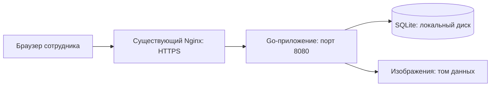

# Корпоративная база знаний — спецификация

Дата: 2026-11-01. Статус: проект для проверки пользователем; реализация не начата.

## 1. Назначение и исходное состояние

Внутренняя база знаний компании, разворачиваемая на собственном сервере через Docker Compose. Сотрудники читают и редактируют статьи в браузере, видят авторство и обмениваются постоянными ссылками. Общий бюджет решения — до 1 ГБ ОЗУ.

В репозитории пока только `README.md`: приложения, зависимостей и тестов нет. Этот документ описывает будущую реализацию, а не уже работающие или измеренные возможности.

**Последнее решение пользователя:** Go-приложение работает постоянно. Запуск по запросу, активатор и остановка при простое исключены. Существующий Nginx остаётся в Compose-проекте с другим ПО.

## 2. Требования из обсуждения

- Go на сервере; HTML-шаблоны Go, HTMX и Tailwind CSS для интерфейса.
- SQLite как предложенное начальное хранилище; корректная конкурентная работа обязательна.
- До 1 ГБ ОЗУ для всего решения, включая БД и обслуживающие процессы.
- Отдельная папка со своим Compose-файлом, конфигурацией и данными.
- Постоянно работающий сервис; автоматического выключения при простое нет.
- Чтение доступно всем зарегистрированным пользователям после входа.
- Учётные записи создаёт и выдаёт администратор; публичной регистрации нет.
- Все пользователи могут создавать и редактировать статьи.
- Боковое меню: заголовки категорий, под каждым — названия статей.
- Главная страница с карточками статей.
- Авторство и постоянные ссылки на статьи.
- Визуальное редактирование текста, вставка изображений и редактируемых таблиц.
- Личные черновики перед публикацией.
- Поиск по названию и полному тексту опубликованных статей.
- Без совместного редактирования в реальном времени, графиков и истории опубликованных версий.
- Конкурентное сохранение не должно молча перезаписывать чужие изменения.
- Nginx уже находится в другом Compose-проекте; второй экземпляр для базы не нужен.

## 3. Предлагаемые настройки первой версии

Эти значения предложены при проектировании, а не отдельно выбраны пользователем:

| Область | Предложение |
| --- | --- |
| Размещение | `/opt/knowledgebase`, Compose-проект `knowledgebase`, один контейнер приложения |
| Внешний доступ | Через существующий Nginx и отдельное имя хоста; сеть `knowledgebase-ingress` |
| Права | Все редактируют любые опубликованные статьи; личный черновик доступен только владельцу |
| Администратор | Пользователи, категории, архивирование и восстановление статей |
| Категории | Один уровень, одна категория на статью, порядок задаёт администратор |
| Правки | До публикации изменений читатели видят прежнюю опубликованную версию |
| Авторство | Первоначальный автор, последний редактор и даты |
| Вход | Локальный логин и пароль, обязательная смена временного пароля |
| Сессия | Абсолютный срок 12 часов, хранение в SQLite |
| Изображения | JPEG, PNG, WebP; до 10 МиБ и 25 мегапикселей на файл; без SVG |
| Документ | JSON до 2 МиБ, глубина до 32, не более 10 000 узлов |
| Списки | 20 карточек/результатов на страницу; меню подгружает статьи порциями по 50 |
| Поиск | SQLite FTS5, `unicode61`; русский текст без обещания морфологического поиска |
| Копии | Ежедневно, 14 последних комплектов; внешнее хранение настраивает инфраструктура |
| Проверочная нагрузка | 50 одновременных читателей и 5 авторов, 5 000 статей; это сценарий проверки, а не предел продукта |

## 4. Рассмотренные подходы и выбранный стек

| Подход | Что даёт | Решение |
| --- | --- | --- |
| Django + SQLite + HTMX | Готовую инфраструктуру учётных записей и администрирования | Рассматривался; пользователь затем выбрал Go |
| Kotlin/Ktor, JVM либо GraalVM Native Image | Kotlin и серверные библиотеки; native image потенциально снижает память и время старта | Native-сборка требует проверки совместимости; Kotlin/Native — другого набора библиотек. Пользователь отказался от Kotlin в пользу Go |
| Go + SQLite + HTML/HTMX | Нативный сервер, статические ресурсы, отсутствие отдельного процесса БД | Выбранное направление; пользователей и административные сценарии реализуем в приложении |

SQLite подходит для исходного сценария: небольшое число пользователей, один сервер, локальный диск. Несколько писателей выполняются последовательно; целостность обеспечивается транзакциями и ограничениями, а конфликты правок — проверкой версий. Если потребуются несколько экземпляров приложения или значительно более интенсивная запись, необходим отдельный проект миграции на PostgreSQL. Бесшовная смена БД не обещается.

Технологии: Go не ниже 1.26, `net/http` и `chi/v5`, `html/template`, `modernc.org/sqlite` без CGO, sqlc, встроенные миграции goose, SQLite FTS5. Интерфейс: HTMX 2, Tailwind CSS 4, Tiptap 3 с открытыми расширениями. Node.js 24 LTS нужен только при сборке. Конкретные patch-версии фиксируются при реализации в манифестах и lock-файлах.

## 5. Архитектура

Один исполняемый файл `kb` с командами `serve`, `check`, `admin create`, `backup`, `restore`, `maintenance`. Контейнер запускает один постоянно работающий `kb serve`. Приложение отдаёт HTML, формы, встроенные CSS/JS и защищённые изображения. Отдельные Node.js, Nginx, Redis, активатор или процесс БД в Compose базы не нужны.

`serve` получает эксклюзивную блокировку экземпляра на томе, открывает БД, применяет миграции и только затем принимает рабочие запросы. `/readyz` проверяет реальный доступ к БД; `/healthz` — жизнь HTTP-сервера. `kb check` использует `/readyz` как healthcheck. Ошибка миграции/БД завершает запуск с ненулевым кодом, без ложной готовности.

SIGTERM инициирует завершение активных HTTP-запросов в пределах 15 секунд и закрытие БД. Compose: `restart: unless-stopped`, `stop_grace_period: 30s`. Обычный перезапуск сохраняет подтверждённые изменения и сессии. Устойчивость после аварийного завершения проверяется отдельно.

## 6. Доступ, страницы и редактирование

### Пользователи

Администратор выдаёт локальный логин, отображаемое имя и временный пароль. До смены временного пароля пользователь не получает контент. Пользователь может изменить собственный пароль; администратор — заблокировать запись или выдать новый временный пароль с отзывом сессий. Саморегистрация, почта и SSO не входят в первую версию.

В SQLite хранится хеш случайного session-токена, в браузере — непрозрачная cookie. Истечение, logout, блокировка и сброс пароля проверяются на сервере. Изначальный администратор создаётся CLI с паролем через stdin, не через аргументы или Git. Демонстрационные пользователи не создаются.

### Чтение и меню

Главная содержит карточки: название, фрагмент текста, категория, автор, дата обновления. Сортировка — обновление по убыванию, ID для стабильности. Выбор категории фильтрует карточки. Боковое меню показывает категории и раскрывающиеся списки статей с подгрузкой; оно не требует выгрузить всю базу в браузер.

Адрес статьи — `/articles/{uuid}`. Переименование и перенос в другую категорию его не меняют. После входа читатель возвращается к исходной ссылке; разрешён только локальный относительный адрес возврата. Прямые ссылки не обходят проверку доступа, в том числе к черновикам и изображениям.

### Создание, черновик, публикация

Tiptap поддерживает абзацы, заголовки, жирный/курсив/подчёркивание, списки, цитаты, ссылки, локальную отмену действий, изображения и таблицы с добавлением/удалением строк и столбцов. Изображения вставляются загрузкой, из буфера или перетаскиванием.

Новая статья получает UUID и личный серверный черновик. Для опубликованной статьи каждый редактор работает со своим черновиком от текущей версии. Сохранение черновика — явной кнопкой; уход с несохранёнными изменениями вызывает предупреждение. Автосохранение и офлайн-работа не обещаются.

Публикация одной транзакцией обновляет название, категорию, JSON/обычный текст, ссылки на изображения, последнего редактора, номер версии и индекс поиска. До публикации другим доступен прежний текст. Первоначальный автор сохраняется. Исторические тела версий не хранятся. Администратор может архивировать статью и восстановить её текущую версию; архив не участвует в меню и поиске.

## 7. Данные и конкурентность

| Сущность | Содержимое |
| --- | --- |
| `users` | Нормализованный уникальный логин, имя, хеш пароля, роль, блокировка, смена временного пароля |
| `sessions` | Хеш токена, пользователь, срок, CSRF-данные |
| `categories` | Название, порядок, служебная версия |
| `articles` | UUID, категория, первоначальный автор, опубликованные JSON/обычный текст, версия, даты, архив |
| `drafts` | Статья, владелец, редактируемые поля, версия черновика и базовая версия публикации |
| `media`, `article_media`, `draft_media` | Изображения и привязки для проверки доступа и очистки |
| `articles_fts` | Полнотекстовый индекс только опубликованных неархивных статей |
| `login_limits` | Ограничение неудачных попыток входа, переживающее перезапуск |

Один экземпляр приложения работает с файлом SQLite на локальном диске; NFS и совместное использование файла несколькими контейнерами не поддерживаются. Используются WAL, `foreign_keys=ON` и `busy_timeout=5000` для соединений. Пул записи — одно соединение, чтения — четыре. Короткие транзакции не содержат сетевых действий и обработки изображений. Ожидание записи ограничено контекстом 5 секунд; исчерпание ожидания возвращает повторяемую ошибку без ложного сообщения об успехе.

Сохранение черновика требует ожидаемый `draft_version`. Публикация проверяет также `article_version`, от которой начата правка. Условное обновление и связанные изменения атомарны. Из двух одновременных публикаций от одной версии проходит ровно одна, остальные получают `409 Conflict`. Повторный устаревший запрос тоже конфликтует. Две вкладки одного пользователя защищены проверкой версии черновика.

Интерфейс при конфликте сохраняет введённый текст и отдельно показывает актуальную публикацию. Пользователь может открыть новый черновик и вручную перенести изменения; молчаливого принудительного сохранения нет. Служебные номера версий не являются историей изменений.

Уникальные ограничения защищают логины. Внешние ключи предотвращают висячие ссылки; непустую категорию нельзя удалить без переноса статей и черновиков. Блокировка/сброс пароля и отзыв сессий выполняются атомарно. Отдельная блокировка экземпляра запрещает случайный второй `serve`; административные HTTP-действия работают через тот же сервис записи.

## 8. Редактор, изображения и поиск

Каноническое содержимое — JSON Tiptap. Сервер проверяет допустимые узлы/атрибуты, лимиты и сам строит HTML/обычный текст. Присланный HTML не доверенный. Raw HTML, скрипты, обработчики событий, опасные схемы URL и произвольные стили запрещены. Ссылки допускают `http`, `https` и локальные адреса статей. Изображения ссылаются только на собственный `/media/{uuid}`.

Файлы получают сгенерированные имена и находятся вне публичной статики. Сервер проверяет формат по содержимому, размер и разрешение. Изображение личного черновика доступно только владельцу, опубликованное — зарегистрированным читателям соответствующей статьи. Имя из запроса не используется как путь. Ошибка загрузки/транзакции не повреждает существующие файлы. Непривязанные файлы старше 24 часов удаляет `maintenance`; до удаления они остаются недоступными посторонним.

Одновременно выполняются не более двух загрузок; лишний запрос получает `429` без неограниченной очереди. Размер файла ограничен 10 МиБ, multipart-запроса — 12 МиБ. Декодирование заголовка изображения и проверка разрешения предшествуют дальнейшей обработке.

FTS5 индексирует заголовок и производный текст, включая таблицы. Заголовок имеет больший вес; выдача содержит безопасный фрагмент и ссылку. Ввод трактуется как текст, не сырой язык FTS; кавычки, пунктуация, кириллица и пустой запрос не дают SQL-ошибок. Пустой запрос возвращает список статей. Черновики не индексируются, архив немедленно исключается. Изменение публикации и FTS происходит в одной транзакции.

## 9. Отдельная папка и существующий Nginx

В `/opt/knowledgebase`: свой `compose.yaml`, локальные настройки, `data` с SQLite/изображениями/ключами и каталог копий. `.env`, данные и копии не попадают в Git. Контейнер непривилегированный, корень read-only, временные файлы — ограниченный tmpfs, постоянные — отдельный локальный том.

**Второй Nginx не создаётся.** Текущий Nginx в другом Compose-проекте продолжает владеть публичными 80/443 и TLS. База слушает только контейнерный 8080 без `ports:`. Одинаковый внутренний порт у разных контейнеров конфликт не вызывает; конфликтует публикация одного IP:порта хоста.

Один раз создаётся внешняя сеть `knowledgebase-ingress`. В исходном Compose Nginx сохраняются все прежние сети и добавляется новая. Клиентские сервисы к ней не подключаются. Приложение базы в своём Compose присоединяется к той же сети с уникальным алиасом `knowledgebase-app`. Маршрут Nginx направляет на `knowledgebase-app:8080`; `127.0.0.1` внутри его контейнера означает сам Nginx и здесь не подходит. Внешняя сеть не удаляется при `compose down` одного проекта.

Предоставляются отдельные примеры дополнения Compose Nginx и его `server`-конфига; это фрагменты для переноса с сохранением текущих сетей/маршрутов, не замена чужих файлов целиком. Домен и способ получения сертификата заполняет инфраструктура. `KB_PUBLIC_URL` содержит фактический HTTPS-адрес. Nginx принимает тело до 12 МиБ и ждёт ответ до 20 секунд.

Docker DNS `127.0.0.11`, кеш 10 секунд и динамическое разрешение upstream предотвращают зависание маршрута на старом IP после пересоздания приложения. Проверяется восстановление без перезапуска Nginx. В момент обновления IP возможны краткие 502; после TTL и готовности приложения маршрут обязан восстановиться.

**Подключение сети не равно reload HTTP-конфига.** Для работающего Nginx можно выполнить `docker network connect` без пересоздания, одновременно сохранив сеть в его Compose для будущих обновлений. Либо планово пересоздать только сервис Nginx через `compose up -d --no-deps <service>` с возможным коротким перерывом входящего трафика. HTTP-конфиг проверяется `nginx -t` и штатным reload. Полный клиентский проект не останавливается; его реальные имена/сети не угадываются.

## 10. Память

Compose ограничивает контейнер: `mem_limit: 768m`, `memswap_limit: 768m`, `GOMEMLIMIT=512MiB`, `GOMAXPROCS=2`. Runtime не содержит компиляторов, Node.js или dev-сервисов. Память SQLite, кеш/tmpfs и файловый кеш cgroup учитываются вместе с процессом; измерение только Go heap недостаточно. `GOMEMLIMIT` — мягкая настройка GC, а не жёсткая гарантия общего RSS.

Для консервативной проверки 1 ГБ трактуется как 1 000 000 000 байт: 768 МиБ контейнеру и до 180 МиБ обслуживающему слою вместе составляют 994 050 048 байт. Существующий общий Nginx также обслуживает клиентов: его весь расход нельзя приписать базе или ограничить из нового Compose. При приёмке фиксируются пик нового проекта и добавочный расход ingress при изолированной нагрузке базы. Память чужих клиентских приложений в её бюджет не включается. Доступность резерва на целевом сервере проверяется отдельно; соответствие 1 ГБ до измерений не считается доказанным.

## 11. Безопасность и резервные копии

- Все контентные маршруты проверяют активного пользователя; административные — также роль.
- bcrypt cost 12; пароль не короче 12 символов и не длиннее 72 байт, без молчаливого усечения.
- Session-токен от 32 случайных байт, в БД только хеш. Cookie: HttpOnly, Secure при HTTPS, SameSite=Lax. HTTP разрешается только явно выбранным локальным dev-режимом.
- CSRF-токены и проверка Origin защищают изменяющие запросы. Ключ CSRF создаётся один раз и хранится на томе. Восстановление из копии отзывает старые сессии.
- После 5 неверных паролей на логин за 10 минут попытки блокируются до конца окна; одновременно исполняются максимум две проверки пароля. Ограничение сохраняется в БД.
- Заголовки прокси принимаются только от явно настроенного доверенного адреса/сети. Входящие неавторитетные `Forwarded`/`X-Forwarded-*` не меняют проверки безопасности.
- В логи не попадают пароли, cookie, токены, содержимое статей; пишутся ID запросов, ошибки и результаты операций.

`kb backup` использует согласованный снимок SQLite, включая committed-записи WAL, через поддерживаемый механизм БД. Копирование живого `.db` командой `cp` не используется. Изображения неизменяемы; файловая блокировка на время снимка и копирования запрещает их физическую сборку мусора. Комплект с контрольными суммами становится видимым только после успешного завершения.

Ежедневный запуск — cron/systemd timer хоста с `docker compose exec -T app /app/kb backup`, без дополнительного контейнера. После успешной копии остаются 14 последних комплектов; ошибка сохраняет прежние. Перенос на независимый носитель/сервер настраивается инфраструктурой и проверяется отдельно.

`kb restore` работает только при остановленном приложении, подтверждённом блокировкой экземпляра, в пустой либо предварительно сохранённый каталог. Проверяет контрольные суммы и целостность SQLite до запуска; отзывает сессии. Статьи, черновики, пользователи, ключи и изображения восстанавливаются совместно. Проверочный restore выполняется в другой папке/Compose-проекте, без затрагивания исходного сервиса. `maintenance` согласует удаление файлов с backup и проверяет ссылки на файлы повторно перед удалением.

## 12. Приёмка

1. Администратор выдаёт запись, пользователь меняет временный пароль и входит. Блокировка/сброс пароля отзывает старые сессии. Публичной регистрации нет.
2. После входа доступны меню, карточки и прямые ссылки. Переименование не меняет URL. Без входа контент и изображения защищены; адрес возврата не допускает внешнего перенаправления.
3. Пользователь сохраняет черновик с текстом, таблицей и изображением; другой пользователь не получает его по ID. После публикации материал виден всем зарегистрированным.
4. Ровно одна конкурентная публикация от одной версии успешна, остальные конфликтуют и сохраняют набранный текст. Две вкладки одного пользователя и повтор устаревшего запроса также защищены.
5. Поиск находит кириллицу и текст таблиц, обновляется после публикации/архивирования, не раскрывает черновики, устойчив к кавычкам/пустому запросу.
6. Приложение продолжает работать после простоя. Обычный restart сохраняет сессию, черновик и изображения. SIGTERM завершает текущие запросы; ошибка миграции не даёт ложную готовность. После аварийного завершения БД цела.
7. `go test -race ./...`, браузерные сценарии и интеграция двух Compose-проектов проходят. Пересоздание приложения не требует рестарта Nginx, клиентские сервисы и их тома не изменяются.
8. На целевом сервере: 10 минут, 50 читателей/5 авторов, 5 000 статей, две допустимые предельные загрузки и штатная резервная копия внутри лимита. Фиксируются peak cgroup, добавочный расход ingress и время готовности. Нет OOM, потерянных изменений и ложных успешных ответов; общий добавленный расход не превышает 1 ГБ. Машина, данные и результаты сохраняются в отчёте.
9. Согласованная копия и восстановление в отдельную папку возвращают статьи, черновики, пользователей и изображения. Вход новой сессией работает, старые токены отозваны. Ошибка копии не удаляет успешные предыдущие копии.

## 13. Границы первой версии

Один сервер, один экземпляр приложения и локальная SQLite. Высокая доступность, горизонтальное масштабирование, SSO, ограничения чтения по категориям, онлайн-соавторство, история опубликованных версий, графики, комментарии и произвольные вложения в первую версию не входят. PostgreSQL и отдельный frontend framework потребуют самостоятельного решения при появлении соответствующей нагрузки/сценариев.

Связанный план: [2026-11-01-knowledge-base.md](../plans/2026-11-01-knowledge-base.md).
